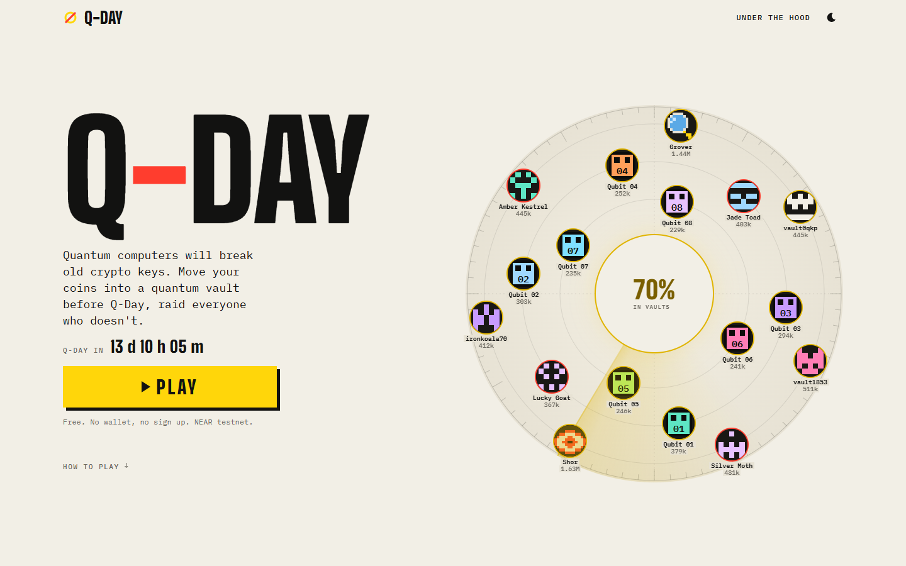
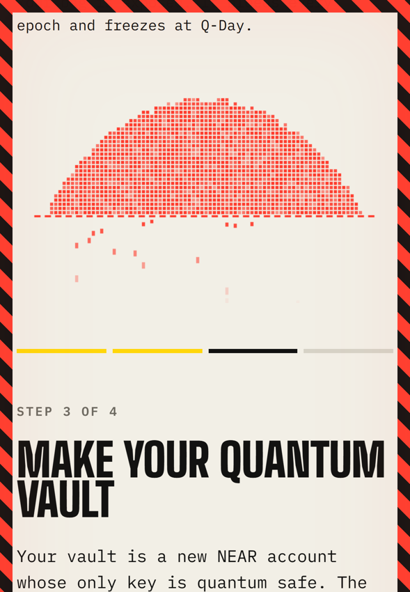

<p align="center">
  
</p>

<h1 align="center">KEYFALL</h1>

<p align="center"><b>A memecoin where the only way to keep your bag is to move it behind a quantum safe key.<br/>The game is hunting everyone who didn't.</b></p>

<p align="center">
  <a href="https://qday-one.vercel.app"></a>
  <a href="https://nearblocks.io/address/keyfall.near"></a>
  <a href="https://testnet.nearblocks.io/address/qday-live-mw6vii9l47s.testnet"></a>
  <a href="https://github.com/jenzylove/qday/actions/workflows/ci.yml"></a>
  <a href="docs/e2e/latest.md"></a>
  <a href="LICENSE"></a>
</p>

<p align="center"></p>

Built at **NEAR HACKATHON** (November 2026). Tracks: **Memecoins With Mechanics** and **Games With Real Economies**. The repo, the practice contract and some code use the codename `qday`.

## The mechanic in one line

**The contract checks which kind of key signed every move.** Bags behind an ordinary key bleed every 6 hours, can be raided and freeze for good on Q-Day. Bags behind a quantum safe key (ML-DSA-65) are safe, earn the bleed and are the only ones allowed to attack.

## Why this exists

A future quantum computer could derive the private key of any classical key whose public key sits on a chain. NEAR made ML-DSA-65 an ordinary account key, but moving to one is opt in, and nobody rotates a key until it costs them something. KEYFALL makes staying on an old key cost something, every 6 hours, in a coin people actually hold.

| | Exposed bag (ordinary key) | Quantum vault |
|---|---|---|
| What it is | Any normal NEAR account holding the coin | `<name>.<contract>`, created by the game, born with **only** an ML-DSA-65 key |
| Every epoch (6 hours) | Bleeds 2.5%: half burned, half paid to vaults | Receives the vault share of the bleed |
| When raided | Cannot defend. Can only escape into a vault | Defends and wins the raider's stake, minus a burn |
| Raid, shield, hit Satoshi | No | Yes, every move signed with the quantum key |
| On Q-Day | **Frozen for good** | Keeps playing and trading |

Every NEAR contract call carries the signer's public key, and its first byte is the key type. The contract refuses any vault move not signed with type `2` (ML-DSA-65): `E_NOT_QUANTUM`. Sources for every fact: [docs/SOURCES.md](docs/SOURCES.md).

## Play it in two minutes

Open **https://qday-one.vercel.app** on a phone or desktop and press **PLAY**. First visits start in the free **practice** arena: no wallet, no sign up, no popups.

1. **We make you a practice wallet and buy your first bag.** It lands red: your coins sit behind an old key, they leak over time and the hunters turn toward you.
2. **Run to the gold gate.** Steer with your thumb (or WASD and the arrow keys). Touch the gate and your vault is built: your coins move into an account whose only key is quantum safe. If a raider caught you first and you escape in time, the raid takes nothing.
3. **Now you're gold, and only gold can shoot.** Shoot a marked rival to raid it. Exposed bags run, so chase them. Vaults fight back.
4. **Stay alive and climb.** Charge a SHIELD so raids take less, DASH away from raiders, and shoot Satoshi's core when it glows. The richest vault at Q-Day wins. Every move is signed in your browser with ML-DSA-65.
5. **Play for real.** After the first mission, switch to the **mainnet** arena: buy $KEYFALL with your own NEAR on `keyfall.near` and play the same rules for real money.

<p align="center"></p>

Prefer to check without playing? Open **Under the hood** (https://qday-one.vercel.app/proof): every check there reads the chain from your browser.

## Two arenas, one contract code

| | Mainnet | Practice |
|---|---|---|
| Contract | [`keyfall.near`](https://nearblocks.io/address/keyfall.near), deployed keyless on 9 November 2026 ([deploy](https://nearblocks.io/txns/CVAtSwnxxq1pxwkV22EtsUPDLQA3GFH4bA61nsS3Eeh7), [`deployments/mainnet.json`](deployments/mainnet.json)) | [`qday-live-mw6vii9l47s.testnet`](https://testnet.nearblocks.io/address/qday-live-mw6vii9l47s.testnet) |
| Money | Real NEAR, real $KEYFALL | Free testnet coins ($QDAY) |
| Q-Day | 23 November 2026, 04:56 UTC | 21 November 2026, 20:47 UTC |
| Rules | [`sim/params-mainnet.json`](sim/params-mainnet.json): same as practice except a 2 hour immunity after a raid ends (24 hours in practice) and up to 6 raids per epoch (3 in practice) | [`sim/params.json`](sim/params.json) |

Before locking the mainnet contract, a spike proved mainnet accepts transactions signed only by an ML-DSA-65 key: an account was created with only a quantum key and then deleted itself with that key ([docs/spikes/s3-mainnet.md](docs/spikes/s3-mainnet.md)).

## Check every claim yourself

| Claim | How to check |
|---|---|
| Only quantum signed moves are accepted | The same `boss_raid` refused with `E_NOT_QUANTUM` when signed with ed25519, accepted with ML-DSA-65: transactions in [docs/e2e/latest.md](docs/e2e/latest.md) |
| Vaults are born quantum only | `/proof` reads every vault's key list live and counts how many hold exactly one `ml-dsa-65` key |
| Nobody can change the rules | The contract accounts have **no access keys**, and `config()` equals the params file field by field |
| The deployed code is this repo | `node scripts/judge-checks.mjs` compares your local wasm build hash with the deployed one. The mainnet wasm hash is in [`deployments/mainnet.json`](deployments/mainnet.json) |
| The books add up | exposed + vaults + market + escrow + burned = 21,000,000, checked live |
| The whole season works, Q-Day included | 33 of 33 end to end checks on a fresh testnet season with real transactions, including frozen bags, stopped raids and `finalize()`: [docs/e2e/latest.md](docs/e2e/latest.md) |
| Harvest cost does not grow with holders | Harvest gas was equal at 4 and 44 exposed holders in the recorded testnet run |

```sh
git clone https://github.com/jenzylove/qday && cd qday
cd scripts && npm install && node judge-checks.mjs
```

`judge-checks.mjs` runs against the practice contract by default (`deployments/testnet-live.json`).

## The rules

- **Supply:** 21,000,000 coins. Satoshi's stash (1,100,000) is an exposed holder that can never move. The rest sits in a bonding curve inside the contract. No team allocation, no admin mint, no outside pool.
- **Harvest:** each epoch (6 hours) anyone can call `harvest()`: 2.5% of every exposed balance, Satoshi included; half burns, half goes to vaults.
- **Raids:** a vault stakes coins against any holder. An exposed target cannot defend but can escape by moving into a vault inside the 10 minute window. A vault target can defend and take the stake. The take is 10% of an exposed bag or 2% of a vault, reduced by its shield, capped at 3 times the stake. No punching down: the target must be at least a quarter of your size.
- **Shields:** burn a share of your bag; strength is the square root of the share (1% buys 10%, 4% buys 20%).
- **Satoshi:** once per epoch each vault can take 0.1% of Satoshi's stash.
- **Q-Day:** raids, harvest and Satoshi stop; every exposed balance freezes for good; `finalize()` writes the season result on chain.

These numbers came from simulation, not guesses: the same rules crate was run over 6 scenarios and 48 parameter sets, which caught small vaults being farmed and led to vault armour and the no punching down rule ([docs/BUILD_LOG.md](docs/BUILD_LOG.md)).

## The hunters

The game's own bots (`shor`, `grover`, `qubit-01` to `qubit-08`) are ordinary quantum vaults playing under the same contract rules. Qubits greet new players with a raid, Shor hunts the largest exposed bag it may raid, Grover hunts the least shielded vault. They defend 2 raids in 3, run the harvest, settle closed raids and pay their own gas by selling part of their bag. The landing page shows how much of the vault total they hold. Their whole behaviour is one readable file with a reason for every move: [`app/npc/rules.mjs`](app/npc/rules.mjs).

## How it works

```
 browser (app/)                        NEAR
 ─────────────                          ────
 ed25519 wallet key   ── buy, migrate ──▶ ┌──────────────────────────────┐
 ML-DSA-65 vault seed ── raid, defend, ──▶ │ keyfall contract (contract/) │
   sealed on device      shield, boss     │  NEP-141 + NEP-145 + game    │
                                          │  rules from core/ (pure Rust)│
 /api/join  sponsor funds a new wallet    │  signer key type check       │
 /api/tick  NPCs move under the same rules│  create_vault: born with one │
                                          │   ML-DSA-65 key              │
 GitHub Actions: crank on a schedule      │  no access keys              │
   (harvest, settle raids, NPC moves)     └──────────────────────────────┘
```

| Folder | What it holds |
|---|---|
| [`core/`](core) | Every game rule as pure Rust: buckets with one share index each (constant gas harvest), raids, shields, Satoshi, the bonding curve, Q-Day. 17 tests including 10,000 random moves that keep the books exact |
| [`contract/`](contract) | The NEAR contract: NEP-141 token, NEP-145 storage, vault creation, the quantum signer check, events and an on chain feed |
| [`sim/`](sim) | The same rules crate simulated over 6 scenarios and 48 parameter sets; the chosen parameters are locked in the params files |
| [`app/`](app) | The site (Vite, TypeScript): landing, `/play`, `/d/<raid id>` defend links, `/proof` |
| [`app/npc/rules.mjs`](app/npc/rules.mjs) | The hunters' whole behaviour in one readable file |
| [`scripts/`](scripts) | Deploy (deploy, init and delete the key in one transaction), end to end run, judge checks, crank |
| [`docs/`](docs) | PRD, specs, spikes, sources, end to end evidence, build log |

## Run it locally

```sh
# site against the live contracts
cd app && npm install && npm run dev

# contract (Rust with the wasm32 target and cargo-near)
cd contract && cargo near build non-reproducible-wasm --no-abi

# tests (Linux or macOS; on Windows the aws-lc-sys dev dependency needs NASM)
cargo test --workspace
cd app && node --test npc/rules.test.mjs
```

CI runs the Rust tests and the wasm build on every push. A clean runner also loads every live route every 3 hours (`sitecheck`).

## Scope

Unaudited. The mainnet contract holds real money; play with what you can lose. A vault owner could later add a classical key to their own vault with their quantum key; `/proof` reads every vault's keys and flags any that did. Moves must be signed directly by the vault: a relayed (gasless) transaction shows the relayer's key, so the contract refuses it.

## Built with

near-sdk (Rust), the `uint` and `borsh` crates, `@fastnear/api`, `@fastnear/ml-dsa-65` and `@fastnear/utils`, Vite and TypeScript, puppeteer-core for the automated checks. Fonts: Jersey 10 and IBM Plex Mono. All code was written during the hackathon (from 7 November 2026), with AI assistance (Claude Code).

## Also by the same author

**Offmap** ([github.com/jenzylove/offmap](https://github.com/jenzylove/offmap)), private loans on Morpho through NEAR. A separate and independent NEAR HACKATHON project. Its README names KEYFALL.

## License

[MIT](LICENSE)
